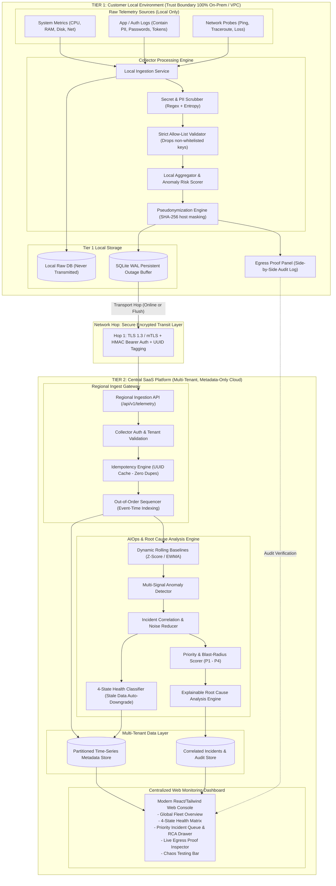

# Phase 2: Master Architecture & Technical Design
**Project:** CICADA 2026 - Secure AIOps Observability Platform  
**Target:** 25 Marks Checkpoint  
**Core Direction:** Local-First Security | Metadata-Only SaaS | AIOps Event Intelligence | Global-Ready

---

## 1. System Overview & The Trust Boundary

The CICADA platform enforces a strict **Two-Tier Architecture** separating the local customer environment from the central multi-tenant cloud. Raw operational data, credentials, and full application payloads **never cross the trust boundary**. Only audited, allow-listed metadata leaves the environment.



---

## 2. Collector-to-SaaS Data Flow Specification

The data lifecycle follows a 6-stage unidirectional pipeline:

```
[1. COLLECT] -> [2. FILTER/REDACT] -> [3. AGGREGATE] -> [4. ANALYZE LOCALLY] -> [5. APPLY DATA POLICY] -> [6. TRANSMIT]
```

1. **Collect:** Ingests raw telemetry from system counters (`psutil`), syslog streams, network ping/packet-loss sockets, and application metrics.
2. **Filter & Redact:**
   - Evaluates incoming text against high-entropy patterns and regex scrubbers.
   - Replaces API keys, tokens, passwords, and private IPv4 ranges with redact tokens (`[REDACTED_SECRET]`, `[LOCAL_IP_MASKED]`).
3. **Aggregate:** Computes windowed rolling means, min/max, percentiles, and counts locally (e.g. 10-second averages) rather than transmitting high-frequency raw bursts.
4. **Analyze Locally:** Evaluates security threat indicators (e.g. detects repeated failed login bursts) inside Tier 1. Generates a risk summary score without emitting raw login usernames or passwords.
5. **Apply Data Policy (Zero-Trust Allow-List):** Passes the aggregated structure through the strict JSON schema whitelist. Any field not explicitly permitted is unconditionally dropped.
6. **Transmit:** Wraps the sanitized metadata into an authenticated, UUID-tagged payload and dispatches it over TLS 1.3 to the assigned regional SaaS endpoint.

---

## 3. Security Controls & Data Protection

| Security Vector | Implementation Detail | Guarantee |
| :--- | :--- | :--- |
| **Field Allow-Listing** | Strict schema validation (`schemas/payload_schema.json`) with `additionalProperties: false`. | No unknown or accidental fields can leave Tier 1. |
| **Secret Scrubbing** | Dual-pass regex + Shannon entropy analyzer. | Strips passwords, bearer tokens, AWS credentials before serialization. |
| **Pseudonymization** | SHA-256 salted hash of hostnames/private IPs (`node-8f2a...`). | SaaS operators can correlate node identity without learning internal private network topologies. |
| **Collector Auth** | Cryptographic HMAC-SHA256 signature and rotating Bearer API tokens. | Prevents rogue data injection into tenant partitions. |
| **Transport Security** | TLS 1.3 encryption for all REST and WebSocket channels. | Immunity to eavesdropping or man-in-the-middle tampering. |
| **Audit & Egress Proof** | Continuous SHA-256 hash log of transmitted payloads stored on local disk. | Provable audit trail showing exact payloads before egress. |

---

## 4. Telemetry Plan: Network & Infrastructure

The collector gathers seven core metric dimensions continuously:

1. **CPU Usage (`metrics.cpu_usage_pct`):** System and user CPU time sampled across all cores.
2. **Memory Usage (`metrics.memory_usage_pct`):** Active physical memory vs total memory.
3. **Disk I/O (`metrics.disk_io_pct`):** Percentage of time disk operations were active; indicates swap thrashing.
4. **Network Latency (`metrics.network_latency_ms`):** Round-trip time (RTT) measured against regional gateways.
5. **Packet Loss (`metrics.packet_loss_pct`):** Ratio of dropped ICMP/TCP echo packets over 10-second window.
6. **Bandwidth Ingress/Egress (`metrics.bandwidth_mbps`):** Interface throughput in megabits per second.
7. **Service Connectivity (`collector_health.status`):** Active TCP health checks to key local service ports.

---

## 5. AIOps Architecture: Baselines, Correlation & Explainable RCA

### 5.1 Dynamic Baselines vs Static Thresholds
Static thresholds (e.g. "alert if CPU > 80%") trigger massive false alarms during normal peak hours.  
CICADA uses **Exponentially Weighted Moving Average (EWMA) + Rolling Interquartile Range (IQR)**:
$$\mu_t = \alpha \cdot x_t + (1 - \alpha) \cdot \mu_{t-1}$$
$$\text{Z-Score} = \frac{x_t - \mu_t}{\sigma_t}$$
An anomaly is flagged only when a metric deviates by $> 3.0\sigma$ from its dynamic baseline for consecutive windows.

### 5.2 Multi-Signal Incident Correlation (Alert Noise Reduction)
When an infrastructure node fails, it typically triggers 5–10 concurrent alerts (e.g. CPU spike, Disk wait, Latency spike, Packet loss, Health check fail).
- **Correlation Algorithm:** Graph-based temporal clustering. If multiple anomalies occur within a 30-second window on the same or related pseudonymized nodes, they are aggregated into **a single Incident Entity**.

### 5.3 Priority & Blast-Radius Engine (Which to Fix First and Why)
Every incident receives an **Impact Score**:
$$\text{Priority Score} = \text{Severity} \times \text{Blast Radius (Downstream Dependencies)} \times \text{Criticality}$$

- **P1 - CRITICAL (Top of Queue):** Database / Gateway / Core Network failures that block downstream services.
- **P2 - HIGH:** Significant performance degradation (>300ms latency, 5% loss) affecting active sessions.
- **P3 - MEDIUM:** Resource saturation (memory creeping towards 85%) on redundant nodes.
- **P4 - LOW / INFO:** Isolated warnings or transient spikes.

### 5.4 Explainable Root Cause Analysis (RCA)
Every alert in the dashboard provides a transparent reasoning drawer:
```
┌────────────────────────────────────────────────────────────────────────┐
│ INCIDENT #108: Database Saturation Cascading to API Gateway [P1]       │
├────────────────────────────────────────────────────────────────────────┤
│ • Why Flagged: Connection pool exhausted (z-score +3.8σ) at 14:02:10   │
│ • Contributing Signals: DB Pool (65%), API Latency (25%), CPU (10%)    │
│ • Root Cause: Unindexed query surge locked connection worker threads.  │
│ • Why Fix First: Blocks 4 downstream customer-facing microservices.    │
│ • Recommended Action: Run emergency pool expansion + kill long queries │
│ • Remediation Safeguard: [Simulate Safe Action] [Rollback Plan Ready]   │
└────────────────────────────────────────────────────────────────────────┘
```

---

## 6. Failure Handling, Local Buffering & Reconnect Resilience

### Behavior During SaaS Outages:
1. **Outage Detection:** If the collector fails to reach the regional SaaS ingest endpoint or receives HTTP 5xx/timeouts:
   - The collector switches from `HEALTHY` to `BUFFERING` mode.
   - Outgoing metadata is routed into the local **SQLite Write-Ahead Log (WAL)** queue (`outage_buffer.db`).
   - The local queue maintains a strict FIFO order with transactional durability.
2. **SaaS Health Degradation:**
   - Tier 2 SaaS runs a heartbeat monitor.
   - If no heartbeat is received from a collector within **30 seconds**, its state shifts to **FAIR**.
   - If missing for **60 seconds**, its state shifts to **POOR** (meeting the SLA target).
3. **Reconnect & Deduplication (Zero Loss, Zero Duplicates):**
   - Once network connectivity is restored, the collector flushes buffered payloads in batches.
   - Every payload carries a unique `payload_id` (UUIDv4).
   - The SaaS platform checks every incoming `payload_id` against its `seen_payloads` table.
   - Duplicate retries are acknowledged with HTTP 200 but dropped from analytics, guaranteeing **Zero Loss and Zero Duplicates**.

---

## 7. Global-Ready Design & Scalability

1. **Regional Ingest Endpoints:** Collectors route metadata to the closest geo-distributed endpoint (e.g., `ap-south-1` for Mumbai, `eu-west-1` for Dublin) to minimize latency (<100ms) and comply with local data sovereignty laws.
2. **Tenant Data Residency:** Each tenant configuration locks their time-series partition to their designated region. Cross-region replication of operational metadata requires explicit cryptographic authorization.
3. **UTC Timestamps + Source Timezone:** All events are serialized in standard ISO-8601 UTC (`timestamp_utc`). The source timezone (`source_timezone`) is preserved for contextual local-time dashboard views.
4. **Out-of-Order Handling:** Time-series storage indexes records by their **event generation time (`timestamp_utc`)**, not arrival time. Buffered records delivered after an outage slide into their correct historical position without distorting trend graphs.
5. **Tenant Isolation Architecture:** Multi-tenancy is enforced at the database query layer with tenant IDs (`WHERE tenant_id = :id`) and dedicated database schema namespaces, preventing cross-tenant data leaks.

---

## 8. Real-Time Performance Target Compliance

| Measure | Hackathon SLA | Architectural Guarantee |
| :--- | :--- | :--- |
| **Collection to Dashboard Latency** | ≤ 10s at 95th percentile | 2s collector aggregation cycle + sub-second WebSocket broadcast to UI. |
| **Threshold Breach to Alert Raised** | ≤ 15 seconds | Stream-processing AIOps evaluator runs inline on ingest. |
| **Collector Offline Detection** | ≤ 60 seconds of last heartbeat | 10s heartbeat cadence; 30s Fair trigger, 60s Poor trigger. |
| **Post-Outage Backlog Delivery** | 100% delivered, 0 lost, 0 duplicates | SQLite WAL local buffer + UUIDv4 idempotency cache. |
